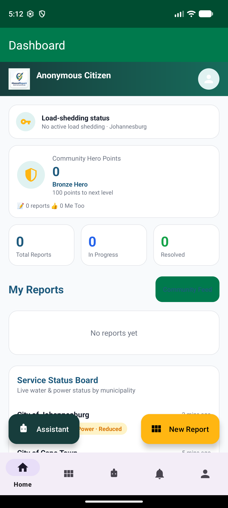
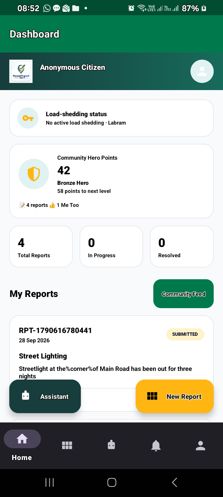
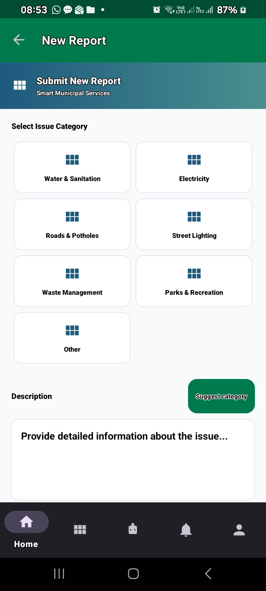
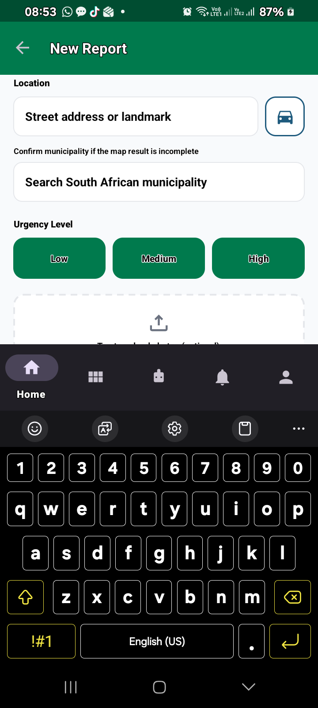
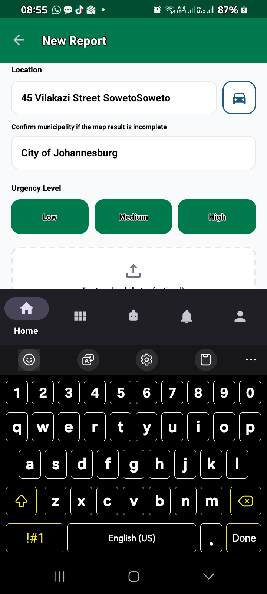
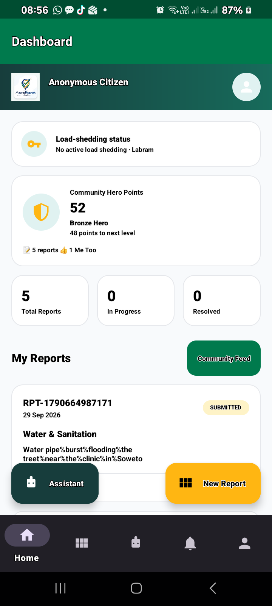
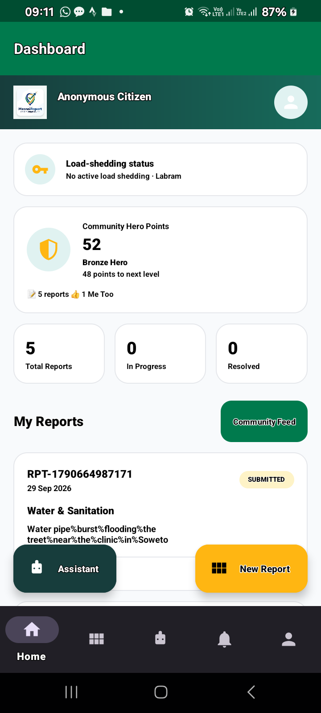

# MzansiConnect: Smart Municipal Service Reporting and Analytics System

---

## Abstract

MzansiConnect is an integrated municipal service-reporting platform that connects
citizens to local-government service delivery. The system comprises four
presentation applications (a React citizen web portal, an Android citizen client,
a staff operations dashboard, and an administrative analytics dashboard) that all
read from and write to a single PostgreSQL-backed Node.js API. This document
describes the purpose, architecture, and interface of each application, presents
captured screenshots of the working system, and documents the database layer that
acts as the authoritative source of truth. The report is intended to serve both as
a technical reference and as an academic record of the implemented system.

**Keywords:** service delivery, e-government, PostgreSQL, REST API, Android,
React, database normalisation, multi-factor authentication.

---

## 1. Introduction

### 1.1 Background

South African municipalities frequently receive service-delivery complaints
through unstructured channels (telephone calls, paper forms, and social media),
which makes prioritisation, tracking, and reporting difficult. MzansiConnect
addresses this by providing one structured pipeline: a citizen submits a report
with a category, municipality, description, and location; the report is committed
to PostgreSQL; and it then appears immediately in municipality-scoped staff queues
and administrative analytics.

### 1.2 Objectives

1. Provide a single, validated intake channel for municipal service reports.
2. Store every report as an authoritative database row with an SLA deadline.
3. Give staff a municipality-scoped queue with controlled status transitions.
4. Provide administrators with database-backed analytics and workforce management.
5. Secure staff and administrative access using password plus one-time MFA codes.

### 1.3 Scope

The system delivers four applications and one shared API against one PostgreSQL
database. Sample analytics and sample outage rows were deliberately removed so
that all dashboards reflect real committed data only.

---

## 2. System Architecture

### 2.1 Component Overview

| Component | Technology | Role |
| --- | --- | --- |
| Citizen Portal (`Citizen Portal Mobile App/`) | Vite + React (TypeScript) | Citizen web intake, tracking, gamification |
| Android Client (`MzansiConnect/`) | Kotlin, Jetpack Compose, Room | Native citizen mobile intake and tracking |
| Staff Dashboard (`Staff Dashboard/`) | Static HTML/CSS/JS | Municipality-scoped operations queue |
| Admin Dashboard (`Admin Dashboard/`) | Static HTML/CSS/JS | Workforce management and analytics |
| API (`backend/`) | Node.js, `pg` | Validation, persistence, auth, realtime events |
| Database | PostgreSQL 16 | Single source of truth |

### 2.2 Data Flow

A citizen submission calls `POST /api/reports`. The API validates the category and
municipality against PostgreSQL reference tables, commits the row (including the
48-hour default `sla_due_at`), then broadcasts a server-sent event on
`GET /api/events`. Staff and administrative clients react by reloading
`GET /api/dashboard`; the Android client refreshes its Room mirror only after the
API confirms. Room is treated as a replaceable display cache, never as the system
of record.

### 2.3 Authentication

Dashboard login is a two-step process. `POST /api/auth/login` verifies the
password and dispatches a one-time code through Resend (email) or Twilio (SMS).
`POST /api/auth/verify-mfa` validates the hashed, ten-minute, five-attempt code and
issues a Bearer token. Provider credentials remain server-side; the web and
Android clients never hold Resend or Twilio secrets.

---

## 3. Citizen Portal (Web)

The citizen web portal is a Vite/React single-page application served on
`http://localhost:5173`. It loads its category and municipality choices from
`GET /api/options`, submits reports, and renders each citizen's own reports by
stable external reference. Notable interface features include a hero landing
section, a guided report form with GPS reverse-geocoding, a load-shedding banner, a
community feed, a citizen assistant, and a gamified leaderboard.

**Figure 3.1 – Citizen portal landing and service-report entry** *(insert web
screenshot here)*

---

## 4. Android Citizen Application

The Android client (`MzansiConnect/`) is a native Kotlin/Compose application that
posts to `POST /api/reports` and mirrors confirmed rows into a local Room
database. It identifies the citizen through a stable `app_users.external_ref`.
The following figures were captured from the running application in an Android
emulator using `http://10.0.2.2:8787/` as the API base URL.

**Figure 4.1 – Application launch and splash**

**Figure 4.2 – Citizen home and navigation**

**Figure 4.3 – Service report form**

**Figure 4.4 – Category and municipality selection**

**Figure 4.5 – Report submission confirmation**

**Figure 4.6 – Report list and status tracking**

**Figure 4.7 – Report detail with SLA countdown**

---

## 5. Staff Operations Dashboard

The staff dashboard is a static client served at
`http://localhost:8080/Staff%20Dashboard/`. After MFA login it presents a
municipality-scoped **Service queue** ("Open work"). Each job card shows the public
reference, category, urgency, description, location, citizen chip, and current
status, with a status selector supporting the transitions *Submitted → Under
review → Assigned → In progress → Resolved → Closed*. A search box filters the
queue by reference, category, or location, and a live-status indicator reflects the
server-sent event connection. A load-shedding status panel queries the backend's
EskomSePush integration.

**Figure 5.1 – Staff sign-in screen** *(insert staff login screenshot here)*

**Figure 5.2 – Staff service queue with status controls** *(insert staff queue
screenshot here)*

---

## 6. Admin Dashboard

The admin dashboard is served at `http://localhost:8080/Admin%20Dashboard/` and is
protected by the same password-plus-MFA flow with the `admin` role. It presents a
**Municipal pulse** header with API-monitoring health, an overview statistic grid,
a load-shedding panel, a **Workforce** panel (active employees and open
assignments), and a **Recent demand** panel (highest-priority reports first). It
also provides the **Add staff member** form that calls `POST /api/staff`, hashing
the password with PostgreSQL `crypt()` and recording municipality, department, and
an optional SMS number. Administrative analytics are drawn from
`GET /api/admin/analytics`, which aggregates category, status, monthly, and
municipality counts from `service_reports`.

**Figure 6.1 – Admin sign-in screen** *(insert admin login screenshot here)*

**Figure 6.2 – Admin municipal pulse, workforce, and demand panels** *(insert admin
dashboard screenshot here)*

---

## 7. Database Layer (PostgreSQL)

### 7.1 Schema

The schema (`backend/schema.sql`) defines enumerated types `user_role`,
`report_status`, and `urgency_level`, and the tables `app_users`,
`service_categories`, `service_reports`, `report_assignments`,
`report_status_events`, `audit_events`, and `auth_mfa_challenges`. Queue, citizen,
assignment, workforce, and MFA indexes support the dashboard access patterns, and
a `touch_updated_at()` trigger maintains `updated_at` on update.

### 7.2 Municipal (Data Normalisation) Migration

Staff accounts are created through an administrative free-text **Municipality**
field, so the same municipality may be stored in several textual forms
("sol plaatje municipality", "Sol Plaatje Local Municipality", "City of
Johannesburg", "Johannesburg"). Without normalisation, a staff member can sign in
and see an empty queue. Migration `003_normalise_municipality.sql` introduces the
`normalise_municipality(value)` function, declared `IMMUTABLE`, which lower-cases,
trims, collapses whitespace, strips an optional "City of"/"Municipality of" prefix,
and strips an optional trailing "Local/Metropolitan/District Municipality" or
"Municipality" suffix. It mirrors `normaliseMunicipality()` in the API so that
application and database comparisons agree, and it is paired with the functional
index `reports_municipality_norm_idx` so municipality-scoped queries remain fast.

**Figure 7.1 – PostgreSQL functional normalisation applied to stored reports**
*(insert your PostgreSQL/pgAdmin screenshot here)*

### 7.3 Reference Data

Service categories are seeded in `service_categories`, and the municipality
directory is populated by the explicit importer (`npm run import:municipalities`),
which aborts unless it reads exactly 8 metropolitan, 44 district, and 205 local
municipalities — it never publishes a partial list. Optional report photos
(migration 006) are stored in `report_photos` and served only to the submitting
citizen or to municipality-scoped staff/admin accounts.

**Figure 7.2 – Municipality reference table in PostgreSQL** *(insert your
PostgreSQL screenshot here)*

**Figure 7.3 – Service reports with normalised municipality values** *(insert your
PostgreSQL screenshot here)*

---

## 8. Evaluation and Discussion

The architecture centralises authority in PostgreSQL, which removes the
divergence that arises when multiple clients hold their own state. Key strengths
are: (i) validated, structured intake; (ii) a single SLA-authoritative deadline;
(iii) role-scoped tokens enforced by the API; and (iv) analytics computed only
from real rows. The principal operational dependency for dashboard access is
Gmail SMTP delivery: seeded `example.gov.za` addresses are placeholders and
cannot receive codes, so production access requires Gmail SMTP credentials and
reachable staff/admin email accounts. For production the system requires HTTPS,
a managed secret store, database backups, rate limiting, and an established
identity provider.

---

## 9. Conclusion

MzansiConnect demonstrates a coherent multi-client service-delivery platform in
which a React web portal, a native Android client, a staff operations dashboard,
and an administrative analytics dashboard share one PostgreSQL system of record.
The documented migrations — in particular the municipality normalisation function —
illustrate how application-level and database-level agreement on data semantics is
essential to correct, non-empty staff queues and reliable analytics.

---

## Appendix A – API Endpoints

| Method | Path | Access | Purpose |
| --- | --- | --- | --- |
| `GET` | `/health` | Public | API and PostgreSQL health |
| `GET` | `/api/options` | Public | Categories and municipalities |
| `POST` | `/api/auth/login` | Public | Check password and send MFA code |
| `POST` | `/api/auth/email/verify` | Public | Verify one-time email code and issue token |
| `GET` | `/api/dashboard` | Staff/admin | Report queue and workforce summary |
| `GET` | `/api/admin/analytics` | Admin | Report aggregates from PostgreSQL |
| `POST` | `/api/reports` | Citizen client | Commit a report and broadcast update |
| `GET` | `/api/reports?externalRef=…` | Citizen client | Read a citizen's reports |
| `PATCH` | `/api/reports/:id/status` | Staff/admin | Update status and audit trail |
| `GET` | `/api/events` | Citizen / staff / admin | Server-sent live updates |

## Appendix B – Migration Order

1. `schema.sql` 2. `002_external_ref.sql` 3. `003_normalise_municipality.sql`
4. `004_mfa_challenges.sql` 5. `005_service_categories.sql`
6. `006_municipalities_and_photos.sql` 7. `npm run import:municipalities`
8. `seed.sql`
